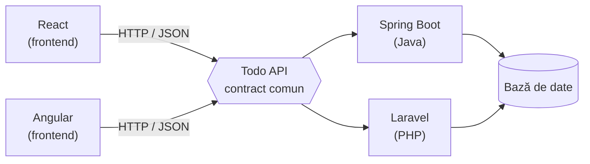

# Framework Atlas 🗺️

Notițele mele despre cele mai folosite framework-uri: ce sunt, cum se folosesc, cum se conectează la baze de date, cum se pun online (deploy), cum vorbesc între ele și cum lucrez în ele cu AI.

Fiecare framework are aceeași structură și un **demo funcțional, testat**. Demo-urile sunt legate între ele printr-un API comun.

<p align="left">
  
</p>

<!-- Bifa de teste (GitHub Actions) apare aici după primul backend. -->

## Arhitectura

Un frontend, mai multe backend-uri interschimbabile. Toate respectă [același contract API](integrations/todo-api.md).



## Progres

| # | Framework | Limbaj | Tip | Status | Demo | API |
|---|-----------|--------|-----|--------|------|-----|
| 1 | React | JavaScript / TypeScript | Frontend | ⏳ urmează | – | – |
| 2 | Spring Boot | Java | Backend | ⏳ urmează | – | – |
| 3 | Angular | TypeScript | Frontend | ⏳ urmează | – | – |
| 4 | Laravel | PHP | Backend | ⏳ urmează | – | – |

**Valul 2:** ASP.NET Core, Next.js, Django / FastAPI, Jakarta EE
**Valul 3:** Vue, NestJS, Flutter / React Native, Svelte

Ordinea e aleasă după piața de joburi din România (Java, .NET, Angular, React) și [Stack Overflow Developer Survey 2025](https://survey.stackoverflow.co/2025/technology).

## Structura repo-ului

```
basics/          ce e un framework, frontend vs backend, API, ORM, deploy
frameworks/      un folder per framework, toate cu aceeași structură
  _template/     șablonul de pornire
integrations/    contractul API comun și cum se leagă framework-urile
comparisons/     tabele de comparație
til/             „Today I Learned”: erori și lecții, cu dată
```

## Ce găsești la fiecare framework

| Fișier | Ce conține |
|--------|-----------|
| `README.md` | ce e, când îl aleg, concepte cheie, întrebări de interviu, **ce a crăpat și ce am învățat** |
| `cheatsheet.md` | comenzi, bază de date, teste, deploy |
| `ai-workflow.md` | cum am lucrat cu AI: fișiere de context, unelte oficiale, unde a greșit AI-ul |
| `demo/` | aplicația, cu testele ei și `CLAUDE.md`-ul real folosit |

## Cum am lucrat (cu AI, la vedere)

Am construit proiectul împreună cu un agent AI (Claude Code). Nu ascund asta, e chiar una dintre abilitățile pe care le arăt aici:

1. AI-ul citește documentația oficială actuală și completează notițele.
2. Construim demo-ul pas cu pas, în commit-uri mici, cu teste.
3. Eu verific, pun întrebări și notez în **„Ce a crăpat și ce am învățat”** fiecare eroare: ce s-a stricat, unde a greșit AI-ul și cum am reparat.
4. Fișierele de instrucțiuni pentru AI (`CLAUDE.md`) rămân în repo, ca să se vadă cum am ghidat agentul.
